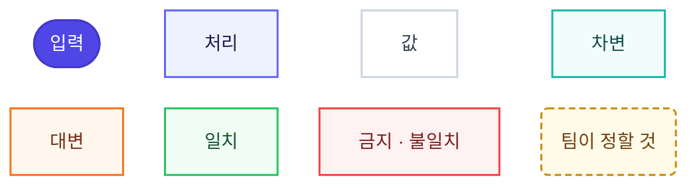
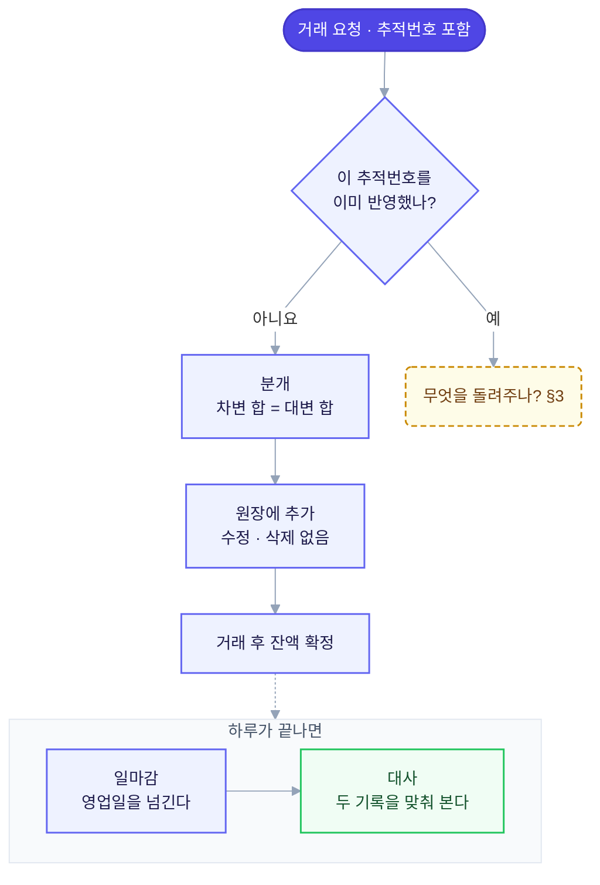
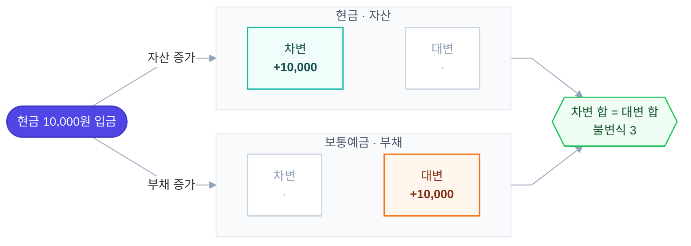
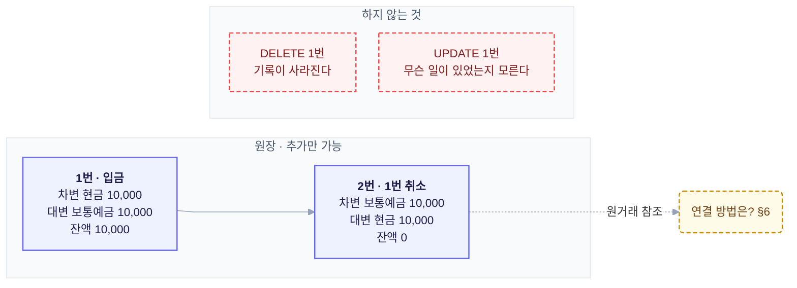
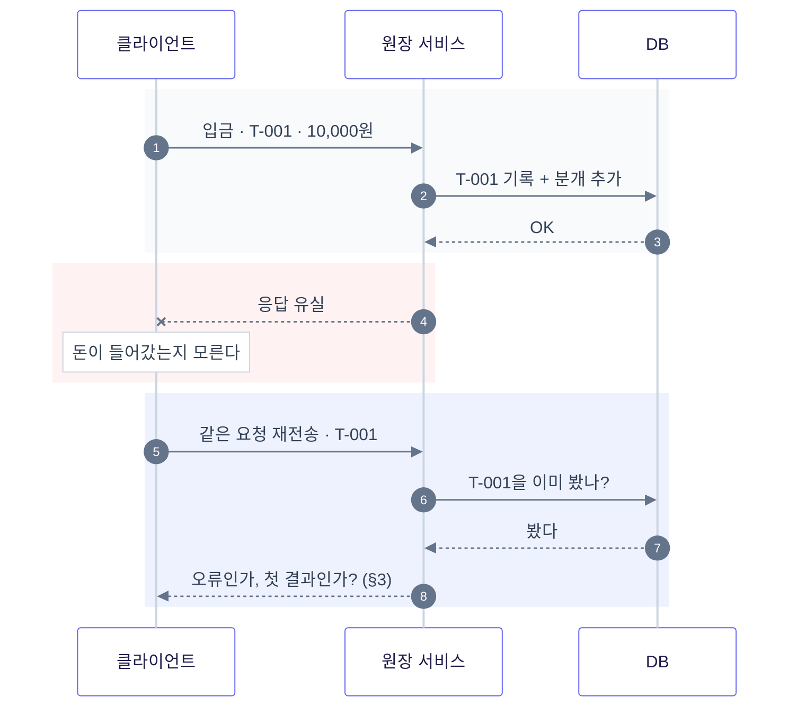
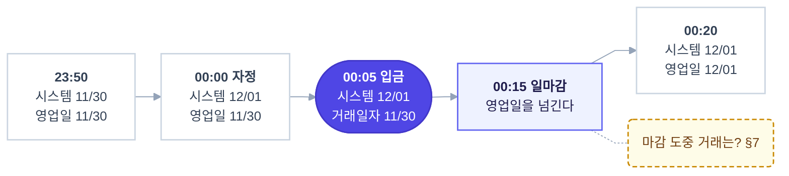
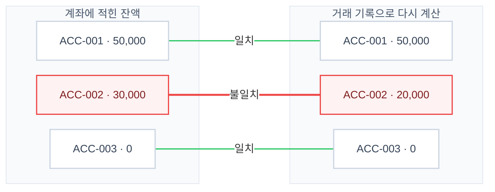

# 사전 지식: 그림으로 보는 원장

`docs/glossary.md`의 용어를 그림 6장으로 정리했다.
설계 질문(`docs/design-questions.md`)의 답은 넣지 않았다. 팀이 정할 자리는 노란 점선 상자로 비워 두었다.

## 범례

---

## 1. 큰 그림: 거래 한 건이 지나가는 길

---

## 2. 복식부기: 입금 10,000원

- 자산은 차변에서 늘고, 부채는 대변에서 는다.
- 예금이 부채인 이유: 은행은 이 돈을 고객이 달라고 할 때 돌려줘야 한다.
- 출금과 이체의 분개는 직접 그려 볼 것 (`design-questions.md` §4, §5).

---

## 3. 취소: 지우지 않고 반대로 한 줄 더

- 2번은 1번의 차변과 대변을 서로 바꾼 분개다. 이것이 역분개다.
- 1번은 그대로 남는다. 그래서 무슨 일이 있었는지 끝까지 추적할 수 있다. 불변식 4가 이 규칙이다.

---

## 4. 멱등성: 응답을 못 받은 쪽이 다시 보낼 때

- 돈은 이미 들어갔는데, 클라이언트는 그 사실을 모른다. 그래서 같은 요청을 다시 보낸다.
- 추적번호가 없으면 10,000원이 두 번 들어간다. 불변식 5가 이것을 막는 규칙이다.

---

## 5. 영업일: 시스템 날짜와 다를 수 있다

00:05 입금의 거래일자는 11/30이다. 시스템 날짜는 12/01이지만, 일마감 전이므로 영업일은 아직 11/30이다. 불변식 8이 이 규칙이다.

---

## 6. 대사: 두 기록을 맞춰 본다

대사는 불일치가 난 계좌를 찾아내는 작업이다. 두 값이 다르면 어딘가에서 장부가 깨진 것이다. 불변식 6이 이 규칙이다.

---

## 그림 고치는 법

- 그림은 모두 Mermaid 코드 블록이다. GitHub이 자동으로 그림으로 바꿔 보여 준다.
- 고친 결과는 https://mermaid.live 에 코드 블록 내용을 붙여 넣어 미리 볼 수 있다.
- 색은 범례의 `classDef` 8개만 쓴다. 새 색을 만들지 말고, 뜻이 맞는 역할을 골라 붙인다.
  - 진하게 칠한 `input`은 그림 하나에 하나만 쓴다. 그림의 출발점이다.
  - `danger`와 `open`은 각각 금지·불일치와 미결정에만 쓴다.
- 각 블록의 첫 줄(`%%{init: ...}%%`)은 그대로 복사해서 쓴다. 이 줄이 있어야 GitHub의 라이트 모드와 다크 모드에서 글자가 모두 보인다.
